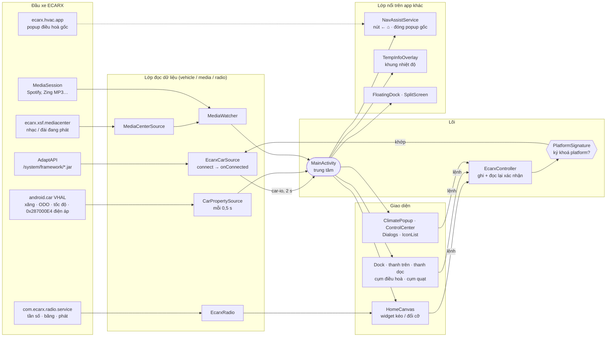
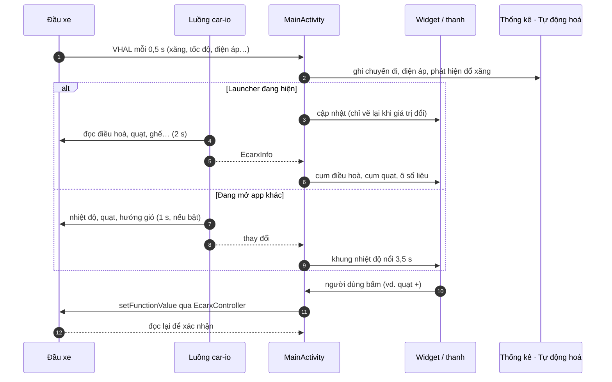
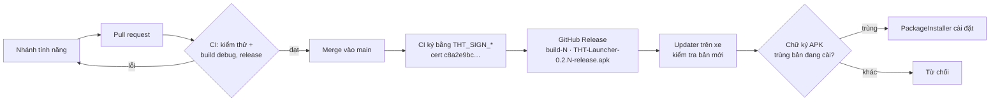

# Sơ đồ làm việc của THT Launcher

Đầu xe Geely Coolray 2025: ECARX SX11-LA (IHU730P), Android 9 API 28, màn 1920×720 @160 dpi, AdaptAPI 1.1.18.9.
Xem thêm: [ecarx-reference.md](ecarx-reference.md) (mã chức năng, cảm biến, thuộc tính xe).

## 1. Toàn cảnh: dữ liệu xe → launcher → màn hình

Mọi nguồn dữ liệu xe đổ về `MainActivity`, từ đó phát cho widget, các thanh và lớp nổi. Lệnh điều khiển đi ngược lại
qua `EcarxController` và chỉ ghi được khi APK ký đúng khoá platform.

## 2. Một vòng cập nhật

Đọc ECARX chạy trên luồng phụ `car-io`. Khi đang mở app khác, launcher chỉ ghi chuyến đi và chạy tự động hoá
(cộng 3 giá trị điều hoà mỗi giây nếu bật khung nhiệt độ).

## 3. Từ mã nguồn lên xe

Mỗi việc một nhánh → pull request → CI → merge vào `main`. CI ký bản release bằng keystore trong secret `THT_SIGN_*`
và tạo bản phát hành `build-N`; launcher trên xe tự cập nhật khi chữ ký khớp.

## Các phần chính trong mã

| Thư mục | Việc làm |
|---|---|
| `vehicle/` | Kết nối ECARX (nạp jar hệ thống, chờ kết nối), đọc VHAL, mã chức năng, ghi có xác nhận, kiểm tra chữ ký platform, xe giả cho bản debug |
| `home/` | Khung widget toàn màn hình, các loại widget (nhạc, bản đồ nhúng, radio, ảnh vùng chạm, widget Android), cụm điều hoà và quạt |
| `shortcuts/` | Dock, thanh trạng thái phía trên, thanh dọc, dock nổi trên app |
| `split/` | Chia đôi màn hình: cặp app trái/phải, thanh kéo tỉ lệ |
| `media/`, `radio/` | Bài đang phát (MediaSession và trình phát gốc của xe), điều khiển radio trực tiếp |
| `controls/` | Cửa sổ điều hoà, trung tâm điều khiển |
| `automation/`, `stats/` | Tự động hoá sau khi nổ máy; chuyến đi, đổ xăng, bảo dưỡng, điện áp ắc quy |
| `system/` | Trợ năng (nút ← ⌂, đóng popup gốc, khung nhiệt độ), màn hình chờ, dọn dẹp RAM, tự mở app, thời tiết, tự cập nhật |
| `ui/`, `settings/` | Màu theme ngày/đêm, icon, font, hộp thoại chung; màn Cài đặt, sao lưu, chẩn đoán |

## Kiểm chứng trên xe

Các phần cần dịch vụ của xe mới thử trên emulator với xe giả. Trên xe: Cài đặt → Xe → **Chẩn đoán** →
**Lưu báo cáo đầy đủ** (lưu file .txt, ví dụ vào USB) rồi gửi file để đối chiếu.
